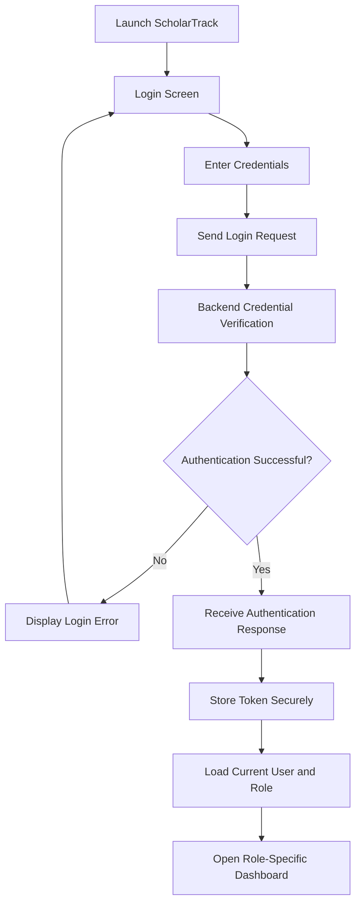
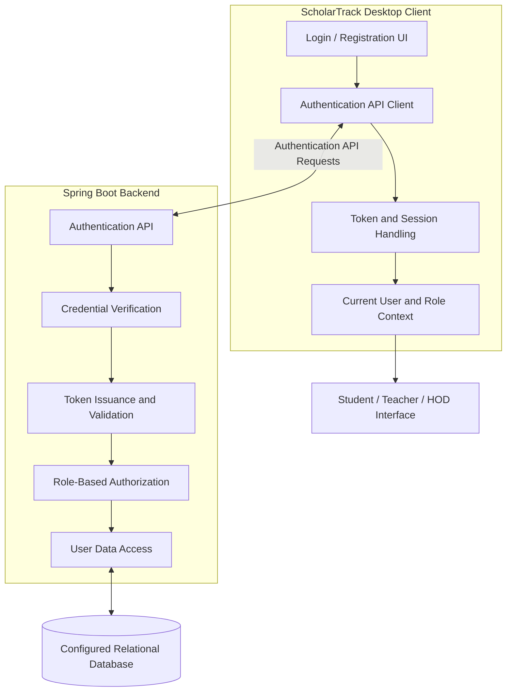
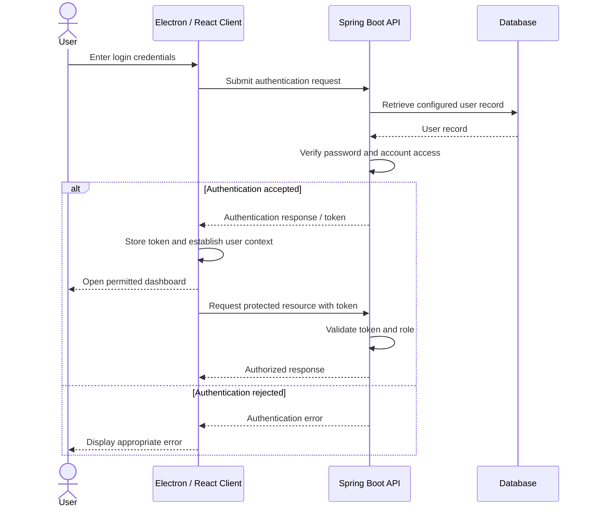

::: {align="center"}
# 🔐 ScholarTrack --- Authentication & User Management

### Module Documentation

**Module Owner:** Devansh Maini (24EARCS044)\
**Project:** ScholarTrack --- AI-Assisted Academic Management and
Performance Monitoring System\
**Institution:** Arya College of Engineering & IT, Jaipur, Rajasthan\
**Department:** Computer Science and Engineering (CSE)\
**Project Guide:** Er. Ram Babu Buri, Assistant Professor, Department of
CSE\
**Academic Session:** 2026--2027

**The authentication and access-control foundation for ScholarTrack's
Student, Teacher, and HOD workflows.**
:::📑 Contents
1. Module Overview
2. Objectives
3. Functional Scope
4. Architecture and Workflows
5. Security and Error Handling
6. Integration with Other Modules
7. Testing and Verification
8. Development and Configuration
9. Limitations and Future
   Improvements
10. Conclusion
1. Module Overview
The Authentication and User Management module is the entry point to
ScholarTrack. It establishes the identity of a person using the
application and supports the access restrictions required by different
user roles.

ScholarTrack provides role-specific areas for Students, Teachers, and
HOD or administrative users. These areas must not be accessible to every
account without restriction. The authentication module works with the
backend to verify login credentials, establish an authenticated user
context, and support authorization checks for protected operations.

The module is part of the integrated desktop application. The frontend
provides the login and registration experience, while the Java Spring
Boot backend is responsible for credential verification, token handling,
and server-side access enforcement according to the project's configured
implementation.
2. Objectives
The primary objectives of this module are to:
1. Provide a consistent login workflow for registered users.
2. Support secure credential verification through the backend.
3. Establish an authenticated session using the configured token-based
   authentication workflow.
4. Identify the current user and their assigned role.
5. Support role-based access for Student, Teacher, and HOD or
   administrative users.
6. Protect API requests that require authentication.
7. Handle authentication, authorization, and server errors
   appropriately.
8. Support controlled registration and administrator authorization of
   newly created accounts.
9. Provide a shared authentication foundation for the other
   ScholarTrack modules.
3. Functional Scope
3.1 Login Workflow
The login workflow accepts credentials entered through the desktop
application's login interface and sends them to the backend using the
defined API contract. The backend verifies the submitted credentials
against configured user records.

On successful authentication, the application proceeds to its
authenticated state and loads the appropriate role-specific area. If
authentication fails, the interface should display a clear error without
exposing sensitive information about stored accounts.

3.2 Credential Verification and Password Handling
Credential verification belongs on the backend. The frontend must not
decide whether a password is valid by comparing it with a hard-coded
value.

Passwords must not be stored as plaintext database values. The backend
should verify credentials using the configured password-hashing
mechanism, such as the project's BCrypt-based password encoder where
that is the mechanism used by the implementation.

The client should not log or expose passwords in application messages,
source code, or documentation.
3.3 Token-Based Authentication
The project uses a JWT-based authentication workflow where configured.
After successful login, the backend can issue a signed token that the
client uses for subsequent protected API requests.

The frontend API layer must attach the token in the format expected by
the backend. The backend validates the token before allowing access to
protected operations.

The client should handle missing, invalid, and expired tokens,
unauthorized API responses, and network or backend availability errors
in a controlled manner. An unauthenticated or invalid request must not
expose protected application data.
3.4 Role-Based Authorization
ScholarTrack includes role-specific application areas:
  Role                                Intended access area
  Student                             Student dashboard and permitted
                                      personal academic information

  Teacher                             Teacher dashboard and permitted
                                      teaching workflows

  HOD / Administration                Departmental and administrative
                                  views permitted to the role
The authentication and user management layer supports identifying the
authenticated user's role and applying role restrictions to protected
endpoints.

The frontend may hide controls that do not apply to a role, but this is
only a usability measure. The backend must enforce permissions
independently because a client can be modified or API requests can be
sent outside the normal interface.
3.5 Current-User Context
After login, the application needs a reliable way to determine the
current authenticated user and their role. This context is used to
display the appropriate dashboard, present user-specific information,
control role-appropriate navigation, and make authenticated requests.

The identity and role shown by the client should remain consistent with
the backend's authenticated context.
3.6 Registration and Account Authorization
The application provides a registration path for users who need to
create a new account. Registration and authorization are separate steps:
creating an account does not necessarily grant immediate access to
protected areas.

Newly registered accounts require administrator authorization before
they can access the application, according to the project's stated user
workflow. The application should communicate the pending-authorization
state clearly, and the backend must enforce this requirement.
3.7 Protected API Integration
The shared frontend API layer should handle common requirements for
authenticated requests. This avoids each screen implementing token
handling differently and supports consistent handling of common API
errors.

Protected endpoints should return appropriate responses when a request
does not contain valid authentication, a token is invalid or expired,
the authenticated user lacks the required role, or the requested
operation is outside the user's permitted scope.
4. Architecture and Workflows
4.1 Module Architecture
The module spans the desktop client and the Spring Boot backend. The
client collects credentials and maintains the authenticated application
state. The backend verifies credentials and enforces access rules.

This diagram describes the module's responsibilities at a logical level.
Exact controller names, endpoint paths, token storage implementation,
and database entities must be taken from the submitted source code.
4.2 Authentication Sequence
1. A user opens the ScholarTrack desktop application.
2. The login interface collects the user's credentials.
3. The frontend sends the authentication request to the backend.
4. The backend verifies the credentials using its configured
   password-verification mechanism.
5. If the credentials are valid, the backend returns the configured
   authentication response.
6. The frontend processes the response and stores the token using the
   application's configured secure-storage mechanism.
7. Subsequent protected requests include the authentication token in
   the expected request header.
8. The backend validates the token and checks the user's role and
   permissions.
9. The application displays or performs only the operations permitted
   for that user.

5. Security and Error Handling
Security is a core responsibility of this module because ScholarTrack
handles role-specific academic information.
  Security area                       Responsibility
  Password handling                   Store password hashes, not
                                      plaintext passwords

  Credential verification             Verify credentials on the backend

  Token handling                      Validate signed tokens and handle
                                      invalid or expired tokens

  API protection                      Require authentication for
                                      protected endpoints

  Role enforcement                    Apply permissions on the backend

  User context                        Keep client identity and role
                                      consistent with the backend

  Secret management                   Keep signing secrets and
                                      credentials out of source control

  Error handling                      Avoid exposing stack traces,
                                      hashes, tokens, or internal
                                      configuration

  Registration                        Enforce administrator authorization
                                  before granting access
Important: Hiding a button or screen in the frontend does not secure
an endpoint. Authorization must be checked by the backend for every
protected operation.
Expected error handling
  Condition                           Expected application behavior
  Incorrect credentials               Display a clear login failure
                                      message

  Missing credentials                 Prompt the user to complete
                                      required fields

  Missing token                       Do not treat the request as
                                      authenticated

  Invalid or expired token            Reject protected access and follow
                                      configured session handling

  Insufficient role permissions       Deny the operation and show an
                                      appropriate access message

  Backend unavailable                 Display a connection or
                                      service-unavailable message

  Registration awaiting approval      Inform the user that administrator
                                  authorization is required
Authentication failures, authorization failures, and server errors are
different cases and should not be treated as identical.
6. Integration with Other Modules
Authentication and user management is a shared foundation for the other
ScholarTrack modules.
  Module                  Team member             Integration
  Student Module          Aryan Kumar Singh       Identifies the
                                                  signed-in student and
                                                  protects access to
                                                  permitted student
                                                  records

  HOD and Analytics       Akshita Mawaliya        Supports HOD or
                                                  administrative role
                                                  identification and
                                                  protected departmental
                                                  operations

  Teacher Module          Awantika Jaiswal        Identifies the teacher
                                                  and supports access
                                                  restrictions for
                                                  teaching workflows

  Academic Data and       Aviral Joshi            Supports authenticated
  Reports                                         access and role
                                                  restrictions for shared
                                                  academic data and
                                              reports
The role names, token format, user identity, API response structure, and
error behavior must remain consistent across modules. Changes to the
login response or security configuration should be communicated to other
contributors.
7. Testing and Verification
The following checks are relevant to the authentication and user
management module. Mark a check as passed only after it has actually
been executed against the submitted build.
- [ ] Valid credentials allow the user to authenticate.
- [ ] Invalid credentials are rejected.
- [ ] Empty required login fields are handled clearly.
- [ ] Successful login establishes the expected authenticated state.
- [ ] The authentication token is processed and stored using the
  configured mechanism.
- [ ] Protected requests include authentication in the expected
  format.
- [ ] Requests without a valid token cannot access protected
  resources.
- [ ] Invalid or expired tokens are rejected.
- [ ] Student accounts cannot access HOD-only operations.
- [ ] Teacher accounts cannot access operations outside their
  permitted scope.
- [ ] HOD or administrative operations are restricted to authorized
  roles.
- [ ] Newly registered accounts remain subject to administrator
  authorization.
- [ ] Authentication and authorization errors are handled distinctly.
- [ ] Backend unavailability is communicated without exposing internal
  details.
- [ ] Logout or session termination follows the application's
  configured behavior.
Testing principles
- Test through the packaged desktop application as well as the
  development environment.
- Verify backend authorization directly; do not rely only on hidden
  frontend controls.
- Use test accounts and synthetic data.
- Never include real passwords, tokens, signing secrets, or private
  user data in screenshots or documentation.
8. Development and Configuration
This module is part of the integrated ScholarTrack application. Exact
commands, environment variables, API paths, and configuration values
depend on the checked-in repository.
Frontend
Run frontend commands from the directory containing the relevant
package.json:
npm install
npm run dev
Use the scripts defined in package.json for production builds and
desktop packaging.
Backend
The authentication endpoints and security rules are provided by the Java
Spring Boot backend. Start the backend using the build tool and
instructions configured in the repository. Ensure that the database
connection and required environment-specific values are configured.
Configuration and secrets
- Keep JWT signing secrets and other private values on the backend.
- Do not commit credentials, tokens, database passwords, or AI
  provider keys.
- Do not hard-code demo credentials into public documentation unless
  the project team has explicitly approved those test credentials for
  distribution.
- Keep frontend and backend API contracts aligned.
Deployed backend
The project uses the following backend health-check endpoint for
deployment availability checks:

ScholarTrack Backend Health
Check

The backend is hosted on Render's free plan. Following a period of
inactivity, the service may need time to wake up. Opening the
health-check URL can initiate a request to the service, but a successful
health response does not guarantee that every protected API or external
integration is functioning.
9. Limitations and Future Improvements
Potential improvements for this module include:
- Expanding automated tests for authentication, token validation, and
  role-based authorization.
- Improving session lifecycle handling and user-facing authentication
  feedback.
- Adding clearer account-pending-approval and account-status
  experiences.
- Improving security logging while ensuring passwords and tokens are
  never recorded.
- Reviewing token storage and session behavior against desktop
  application security requirements.
- Documenting the exact authentication API contract and
  role-permission matrix.
- Adding additional security checks as the application grows.
These are possible future improvements, not claims that they are already
implemented.
10. Conclusion
The Authentication and User Management module provides the identity and
access foundation for ScholarTrack. It supports the login process,
credential verification, authenticated API communication, current-user
context, and role-aware access restrictions.

Because the Student, Teacher, and HOD modules depend on a consistent
understanding of who is signed in and what that user is permitted to do,
authentication must remain aligned with the shared backend API and
security configuration. Reliable integration and backend-enforced
authorization are essential to protecting the academic information
managed by the application.
::: {align="center"}
**ScholarTrack \| Authentication & User Management**\
**Developed by Devansh Maini (24EARCS044)**\
Arya College of Engineering & IT · Academic Session 2026--2027
:::
